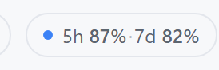
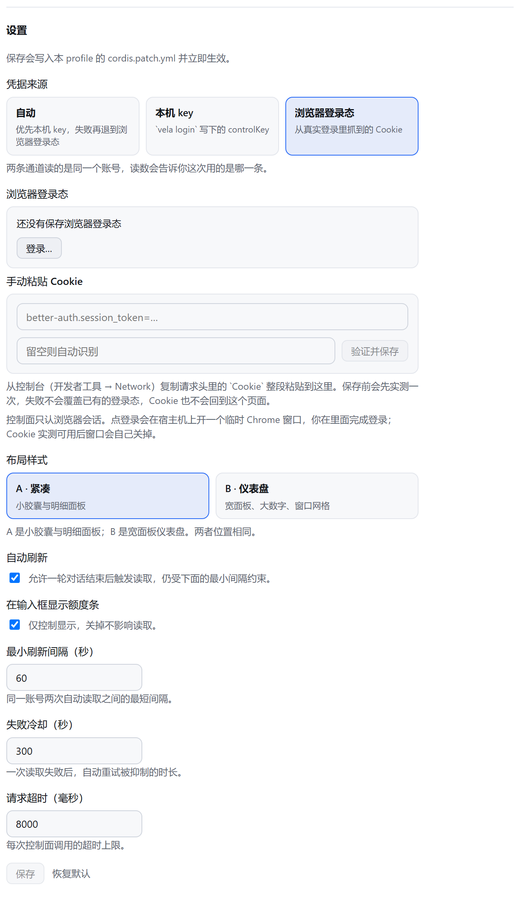
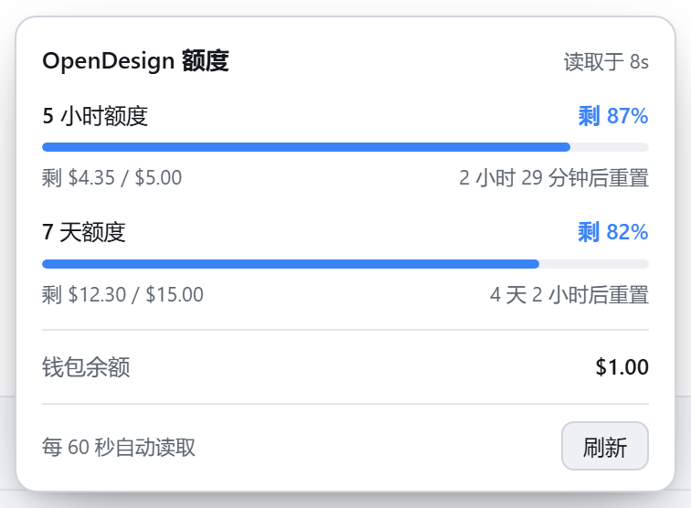
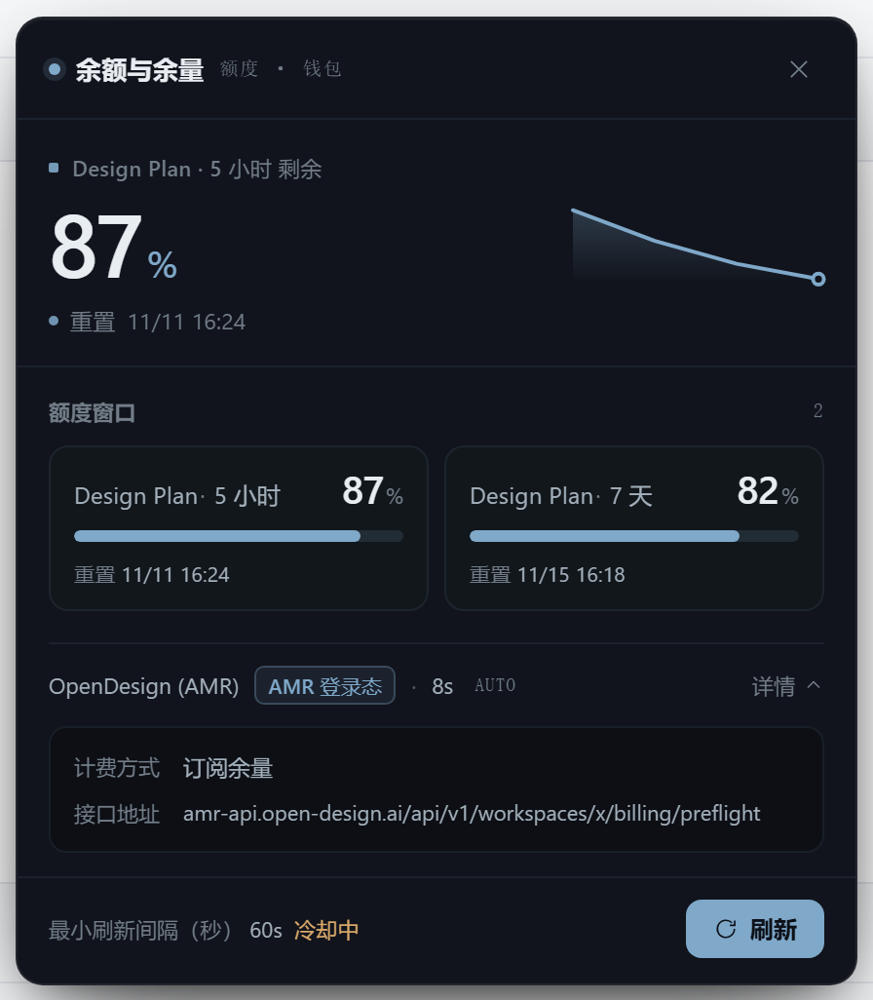

# dsh-opendesign-limit

在 DSH Web GUI 里显示 **OpenDesign (AMR) 订阅额度**的插件：输入框旁的额度胶囊、一个配置它的设置页，以及供 Agent 调用的 `opendesign_limit` 工具。

Design Plan 的额度按两档滚动窗口走——5 小时、7 天一档，余额随时在动。官方账单页要开浏览器登录才能看，而最想知道「还能不能继续跑」的时刻，恰恰是提交之前。所以这个数字就放在你正在打字的那一行上。

```
[附件] [工具]                        ● 5h 96% · 7d 95%   [↑]
```



设置页只放配置，不放数字：



---

## 读的是什么

| 项 | 值 | 来源 |
|---|---|---|
| 5 小时窗口 | 50,000 credits | `billing/preflight` → `codingPlan.windows[]` |
| 7 天窗口 | 150,000 credits | 同上 |
| credits → 美元 | 10,000 : 1 | `GET /api/v1/billing/summary` → `creditsPerUsd`；读不到才退回常量 |

百分比由**精确的 credits 字符串**在 BigInt 里算出，不经过浮点。条形图渲染的是宿主算好的数字，前端一次都不重算——所以它永远不可能和你自己打开控制台看到的不一致。

接口没给出可用限额的窗口会被标注，不会画成 0%。

---

## 外推天数

「照当前速度还能撑几天」——回答的是能操作的那个问题：**这个窗口会不会在重置前用完？**

- 消耗速率取自**窗口自身**的锚点（`windowStart`，缺失时用 `resetsAt − durationSeconds` 反推）。它不依赖进程活了多久，所以刷新页面、重启插件、换台机器看，结果都一样。
- 同时显示窗口离重置还有几天，两者比较。**外推天数 < 距重置天数**标黄，不足一天标红。
  - 3 天用完 / 还有 6 天才重置 → 不用管
  - 3 天用完 / 还有 1 天就重置 → 该收手了
- 本窗口还没消耗时明说「还没消耗」，不说「0 天」——那读起来像立刻见底。

---

## 三个界面

| 位置 | 内容 |
|---|---|
| 输入框（`conversation.input.right`） | 额度胶囊与它的展开面板。样式 A 是紧凑胶囊 `● 5h 96% · 7d 95%`，样式 B 是宽面板仪表盘 |
| 设置页（`settings.section`，菜单名 **OpenDesign**） | **只有配置**：凭据来源、登录、粘贴 Cookie、布局、刷新与超时 |
| 插件页（`plugins.bundle.config`） | 同一份 config scope，挂在插件行上 |

**额度数字不在设置页上。** 同一组数字摆在三个地方，只会让人开始怀疑哪个是准的。设置页回答「它怎么拿到数的」，胶囊回答「还剩多少」。

设置页的导航图标是 OpenDesign 官方 mark（`icon.svg`，291×291 矢量）。外壳按 16 CSS 像素绘制，所以图标以**路径几何**渲染而不是图片：官方文件写死了 `fill="#202020"`，深色主题下等于黑底上的黑；用 `currentColor` 才跟着主题走，与外壳自带图标一致。

**胶囊只在会话当前模型属于本供应商时出现。** 别的 provider 花的是另一份额度，把 OpenDesign 的数字摆在别人的请求旁边就是误导。会话刚打开、选择还没解析的那一小段仍然显示（fail-open）——一次失败的选择读取不该被读成「插件没了」。

---

## 两种布局

`layout` 决定渲染哪一套组件树。两套是独立实现，不是换颜色：

| | A · `compact` | B · `studio` |
|---|---|---|
| 入口 | 28px 胶囊，一行 `5h 96% · 7d 95%` | 显示单条窗口读数的 chip |
| 展开 | 明细面板：逐条窗口条形、金额、倒计时 | 430px 仪表盘：大数字、走势线、双列窗口网格 |
| 配色 | 跟随宿主主题令牌 | 固定的深色仪器面板（石板） |
| 落点 | `conversation.input.right`，`order: 40` | 同左，**位置完全一致** |

两套用类名前缀隔开——A 是 `odg-*`，B 是 `dsh-balance-*`——共存于同一份样式表。

**A · 紧凑**：胶囊本身一行读完，点开才是明细——



**B · 仪表盘**：一屏给出全部窗口，还带一条按真实读数画的走势线——



**只有一套配色。** B 原来提供 AMBER / SLATE 两种，标题栏里有切换按钮。既然只剩一种，按钮和它背后的切换机制一起去掉了：留一套配色却留一个只能重复选同一个结果的按钮，没有意义。

B 其余的开关在设置页，并且**只在选中 B 时出现**：

| 配置项 | 默认 | 作用 |
|---|---|---|
| `studioSparkline` | `true` | 大数字旁的走势线（真实读数，少于两次不画） |
| `studioMeta` | `true` | 供应商 / 读取时间 / 接口地址展开行 |
| `studioHeroShortest` | `true` | 大数字取最短窗口；关掉则取剩余最少的那个 |

布局切换**点一下立刻生效**，不用等保存。存了不认识的值会退回默认，而不是让读数变空。

---

## 凭据：两条通道

OpenDesign 把「推理」和「账单」拆成两套凭据，而账单本身还有两条不同的读取通道。插件两条都支持，`source` 选走哪条：

| 通道 | 凭据 | 从哪来 | 读哪个接口 |
|---|---|---|---|
| `local` | `controlKey` | `vela login` / OpenDesign 桌面端写进 `~/.amr/config.json` | `billing/preflight` |
| `browser` | 浏览器会话 cookie | 在临时 Chrome 窗口里真人登录，宿主通过 CDP 收割 | `coding-plan-usage`，不通退 `preflight` |

`source` 三档：

| 值 | 行为 |
|---|---|
| `auto`（默认） | 先试 `local`；**只有**本机 key 缺失或被控制面拒绝时才退到 `browser` |
| `local` | 只用本机 key |
| `browser` | 只用已存的浏览器登录态 |

`auto` 为什么 local 优先：本机 key 不需要任何交互。而且只有**凭据层面**的失败才值得换通道——解析失败或网络失败说的是这次请求，不是这把钥匙，换条通道只是把等待时间翻倍。

**两条通道读的是同一个账号**，所以读数会标明这次是谁答的：`local · preflight`、`browser · coding-plan-usage`、`browser · preflight`。看不见来源的数字，就没法和你自己开的控制台对账。

没有第三条走 `sk-amr-…` runtime key 的路：那是推理用的，控制面对每条账单接口都回 401。

### 本机 key 通道

查找顺序 `$AMR_HOME/config.json` → `~/.amr/config.json`。档案由 `OPEN_DESIGN_AMR_PROFILE` / `VELA_PROFILE` 指定，缺省 `prod`，只有一个档案时直接用它。

**插件不向 DSH 要任何密钥。**

### 浏览器通道

控制面只认浏览器会话，登录页还在 Cloudflare Turnstile 后面——没有自动化能替人完成它。所以：

1. 点 **登录…**：宿主在这台机器上开一个**临时 Chrome 窗口**（带远程调试端口和一次性 `--user-data-dir`，绝不碰你平时的 profile）。
2. 你在那个窗口里正常登录。
3. 宿主通过 CDP 收割 cookie，**并且实测调一次接口**：会话 cookie 出现还不够，**接口必须回 2xx**。
4. 只有这时才写入登录态；窗口随即关闭，临时 profile 删除。

cookie 存在 DSH 的**凭据记录**里（`dsh-opendesign-limit/browser-session`）。它不进 `cordis.patch.yml`，也不会变成明文 JSON 文件。浏览器半永远只看到掩码（`set` 加末四位）。

登录面板和粘贴面板**只在 `source = browser` 时出现**。`auto` 不算：它只是会回退到那份数据，而依赖本机 key 的人不该被塞一个他并不使用的通道的登录表单。

每条退出路径都是确定的：成功、失败、超时（5 分钟）、取消、插件卸载，全都走同一套清理。关浏览器用 CDP `Browser.close`（实测约 760ms、exit 0），按 pid 的 taskkill 只是兜底。一次被取消的流程绝不会拆掉顶替它的那次。

**远程访问。** 登录窗口开在**宿主机**的屏幕上。当这次请求是经网络地址进来的（`Host` 不是回环地址），或部署绑定了局域网，插件会把该通道报为不可用并说明原因——而不是让你对着一个看不见的窗口等五分钟。

> 判据是**当前这次请求**的 `Host`，不是部署配置：同一个 GUI，今天本机点开、明天远程点开，可用性跟着请求走。

这时用设置页里的**手动粘贴 Cookie**：从控制台开发者工具里复制整条 `Cookie` 请求头贴进去。它同样要实测通过才写入，**被拒绝的 cookie 永远不会覆盖一个能用的登录态**。

cookie 过期后读数转红并要求重新登录；**退出登录**随时清掉它。

---

## 接口

| 请求 | 用途 |
|---|---|
| `GET /api/v1/workspaces` | 定位计费工作区（优先 `personal`） |
| `GET /api/v1/workspaces/:id/billing/preflight` | 钱包余额加两个 `codingPlan` 窗口（`local` 通道） |
| `GET /api/v1/workspaces/:id/billing/coding-plan-usage` | 两个窗口（`browser` 通道首选） |
| `GET /api/v1/billing/summary` | `creditsPerUsd`、套餐档位、周期结束时间 |
| `GET /api/v1/wallet/balance` | 钱包兜底 |

只连 `amr-api.open-design.ai`（控制面）。推理网关 `amr-link.open-design.ai` 上的账单路径全部 404，不探测。

`browser` 通道先试 `coding-plan-usage`，不通再退 `preflight`，然后**记住哪个通了**，后续读取不再重复探测。这是实测结论、不是假设：同一组路由下，`controlKey` 只被 `preflight` 接受，`coding-plan-usage` 对它回 401；真实会话 cookie 能读到哪个，只能靠那一次实测来定。

---

## 宿主路由

全部在 `/api/**` 后面，也就是 connection 的鉴权围栏后面——未登录的请求到不了；凭据值从不作为响应的一部分下发。

| Method | Path | 用途 |
|---|---|---|
| GET | `/api/opendesign-limit/snapshot` | 读数、通道、掩码后的登录态（`?refresh=1` 强制读取） |
| POST | `/api/opendesign-limit/login` | 打开登录窗口；body `{cancel:true}` 则取消 |
| GET | `/api/opendesign-limit/login/status` | 登录进度 |
| POST | `/api/opendesign-limit/logout` | 清掉已存的登录态 |
| POST | `/api/opendesign-limit/credential` | 手动粘贴 Cookie（实测通过才写入） |

---

## 刷新策略

宿主不轮询。胶囊每 15 秒读一次**宿主缓存**——这是本地请求——由宿主决定这次读能不能变成真实的控制面请求，受最短间隔（默认 60 秒）和失败冷却约束。一轮对话结束（`turn/end`）也会触发一次，另有 30 秒自愈心跳兜底。手动刷新绕过冷却。

**读失败绝不清空数字。** 上一次真实读数继续显示并标记为过期。清空等于宣称这个账号没有额度。

---

## 配置

在 **设置 → OpenDesign**（同一份表单也出现在 **设置 → 内置插件** 的插件行上，两处写同一个 config scope）。

行 id `opendesign-limit`，存在 profile 的 `cordis.patch.yml` 里：

| 字段 | 默认 | 用途 |
|---|---|---|
| `source` | `auto` | 凭据通道：`auto` / `local` / `browser` |
| `autoRefresh` | `true` | 允许自动读变成控制面请求 |
| `minIntervalSec` | `60` | 两次自动读之间的最短间隔 |
| `failureCooldownSec` | `300` | 一次失败后抑制自动重试的时长 |
| `timeoutMs` | `8000` | 每次控制面调用的超时 |
| `composerPill` | `true` | 输入框胶囊开关（仅显示，不影响读取） |
| `layout` | `compact` | `compact`（A）/ `studio`（B） |
| `studioSparkline` | `true` | B：大数字旁的走势线 |
| `studioMeta` | `true` | B：元数据行与接口展开 |
| `studioHeroShortest` | `true` | B：大数字取最短窗口（否则取剩余最少） |

每个字段都是 volatile：在设置页改完立刻生效，不用重启插件。

---

## 工具

`opendesign_limit`（参数 `refresh?`）

返回钱包余额、credits 到美元的汇率、每条窗口的剩余百分比 / credits / 美元 / 重置时间 / `daysToExhaust` / `daysToReset`，以及**这次是哪个通道、哪个接口答的**（`channel`、`resolvedEndpoint`）。

状态不是 `ok` 时，把它的 `message` 原样报给用户——不要自己编数字。

---

## 安装

把插件目录链接进 profile：

```powershell
cmd /c mklink /J "%USERPROFILE%\.dsh\profiles\<profile>\node_modules\dsh-opendesign-limit" "<插件路径>"
```

在 profile 的 `package.json` 里登记：

```jsonc
{
  "dependencies": { "dsh-opendesign-limit": "link:<插件路径>" },
  "dsh": { "profile": { "bundles": ["…", "dsh-opendesign-limit"] } }
}
```

重启 DSH 生效。

---

## License

MIT，见 LICENSE。
